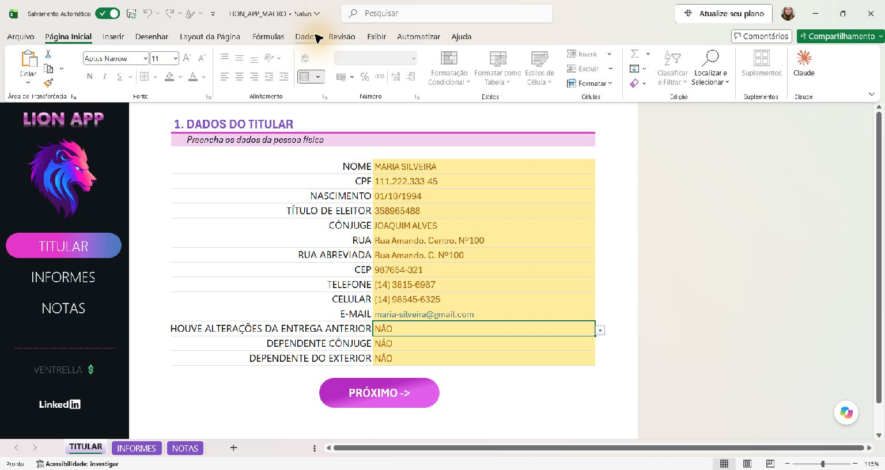
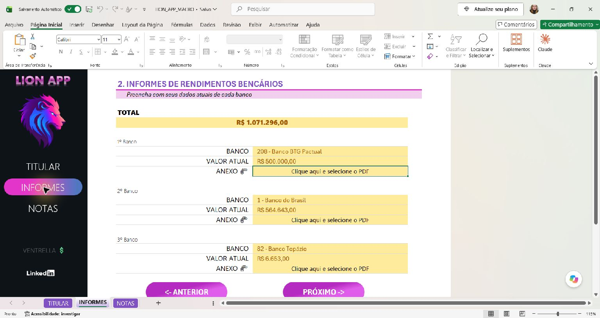
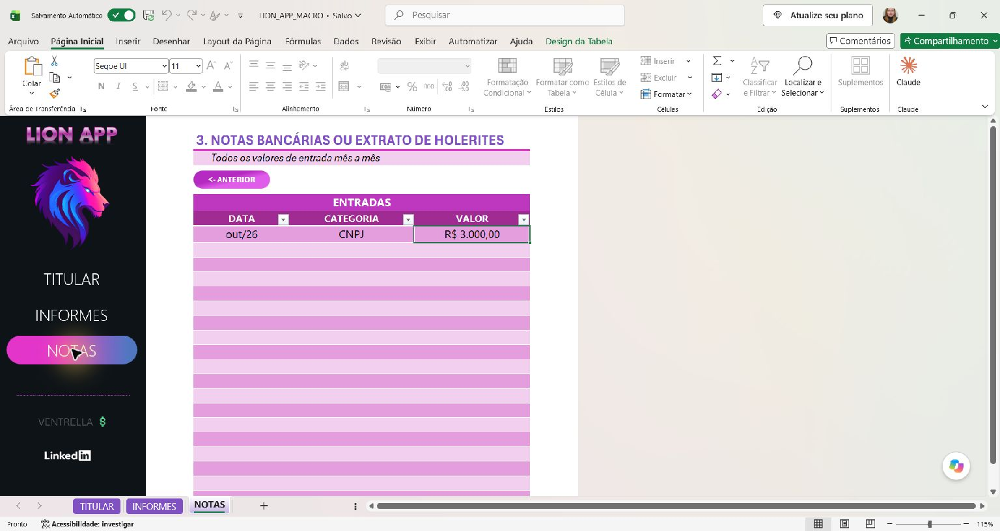
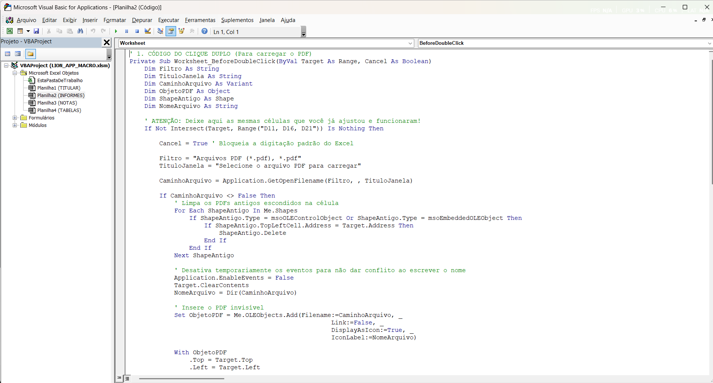
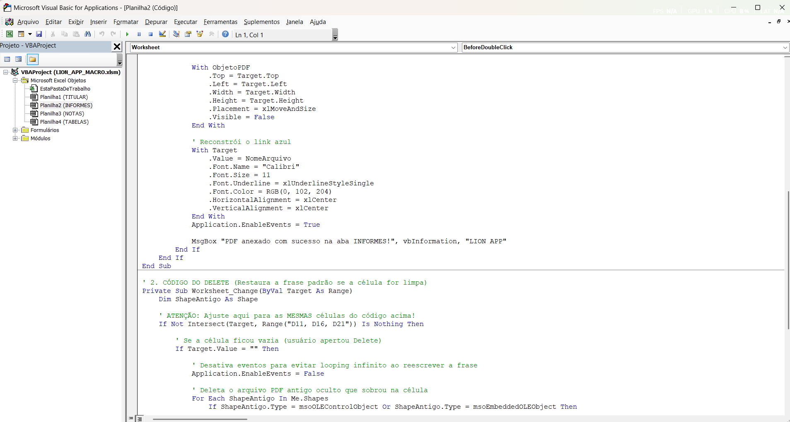
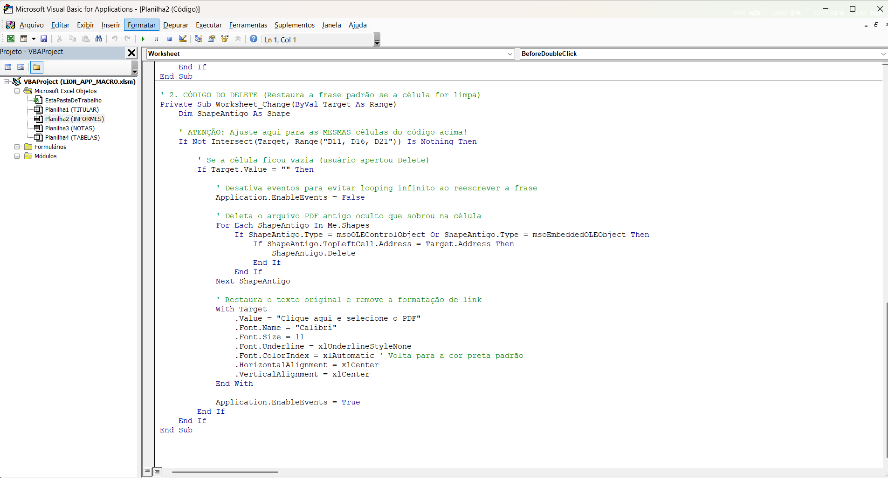

# Lion APP - Declaração de Imposto de Renda

Projeto de estudos em **Excel com VBA**, no contexto dos desafios da DIO. O LION APP reúne dados do titular, informes bancários e registros de entradas em uma interface com navegação entre telas e automação para incorporar PDFs.

**Todos os nomes, documentos, contatos e valores são fictícios, criados exclusivamente para demonstração.**

[Abrir a planilha](LION_APP_MACRO.xlsm) · [Documentação das macros](docs/MACROS.md) · [Mapa técnico](ESTRUTURA.md)

## Objetivo

Centralizar as informações que apoiam a preparação da declaração de Imposto de Renda. O projeto combina cadastro, validações, consolidação de valores e armazenamento de comprovantes, explorando o Excel como uma interface de aplicação.

A planilha organiza informações. A fórmula de totalização soma os valores bancários; não calcula o imposto devido nem transmite uma declaração.

## Tecnologias e recursos

- Excel: abas, campos formatados, tabela de entradas e fórmula de soma.
- Validação de dados: listas de respostas e categorias.
- VBA: eventos de duplo clique e alteração de células em INFORMES.
- OLE: incorporação de PDFs sem vínculo ao caminho original.
- Interface: formas, cores, menu lateral e links internos.
- Formato `.xlsm`: preservação do projeto VBA junto com a planilha.

## Conhecendo a planilha

### TITULAR — Dados cadastrais

Cadastro com nome, CPF, nascimento, título de eleitor, cônjuge, endereço, telefones e e-mail. As perguntas finais usam as opções `SIM` e `NÃO` em `D16:D18`.



### INFORMES — Bancos, valores e comprovantes

Três blocos bancários, cada um com banco, valor atual e uma célula para anexação de PDF.

| Bloco | Banco | Valor atual | Anexo PDF |
| --- | --- | --- | --- |
| Primeiro | D9 | D10 | D11 |
| Segundo | D14 | D15 | D16 |
| Terceiro | D19 | D20 | D21 |

O total em `C6` soma os três valores:

```excel
=SOMA(D10;D15;D20)
```

No arquivo, a fórmula é armazenada como `SUM(D10,D15,D20)`. Os valores fictícios de R$ 500.000,00, R$ 564.643,00 e R$ 6.653,00 resultam em **R$ 1.071.296,00**. Essa soma não agrega os lançamentos de NOTAS.



### NOTAS — Entradas por categoria

Tabela com colunas de **data**, **categoria** e **valor**. A validação em `D8:D26` oferece `HOLERITE`, `CNPJ` e `FREELANCE`. Os controles nos cabeçalhos permitem filtrar os registros.



### TABELAS — Base de apoio

Aba oculta com 50 bancos em `A2:A51`. Separa as referências das telas de preenchimento. A inspeção não identificou validação por lista em INFORMES; a existência dessa base não é apresentada como um menu bancário já conectado aos campos.

## Macros utilizadas em INFORMES

As capturas do editor VBA mostram dois procedimentos no módulo **Planilha2 (INFORMES)**. Ambos atuam sobre `D11`, `D16` e `D21`.

### Worksheet_BeforeDoubleClick — Incorporar ou substituir PDF

Ao dar duplo clique em uma célula de anexo, o código:

1. Usa `Intersect` para verificar se a célula está no conjunto previsto.
2. Define `Cancel = True` para impedir a edição normal por duplo clique.
3. Abre o seletor com `Application.GetOpenFilename`, filtrando PDFs.
4. Se um arquivo foi escolhido, remove os objetos OLE anteriores ancorados naquela célula.
5. Desativa os eventos, limpa a célula e obtém o nome do arquivo com `Dir`.
6. Incorpora o PDF com `Me.OLEObjects.Add` e `Link:=False`.
7. Ajusta posição e tamanho à célula, usa `xlMoveAndSize` e oculta o objeto com `Visible = False`.
8. Exibe o nome em azul e sublinhado, centraliza o texto, reativa os eventos e mostra uma mensagem de sucesso.

```vb
Set ObjetoPDF = Me.OLEObjects.Add(Filename:=CaminhoArquivo, _
                                Link:=False, _
                                DisplayAsIcon:=True, _
                                IconLabel:=NomeArquivo)
```

`Link:=False` incorpora o objeto ao documento. O nome azul e sublinhado é uma formatação visual: o código mostrado não cria um hiperlink nem contém uma rotina para abrir o PDF. Um novo duplo clique inicia outra seleção de arquivo.





### Worksheet_Change — Remover anexo e restaurar o texto

Quando uma célula de anexo é esvaziada, o código:

1. Verifica se a alteração envolve `D11`, `D16` ou `D21`.
2. Confere se o conteúdo ficou vazio.
3. Desativa os eventos para não disparar a própria rotina ao reescrever a célula.
4. Percorre `Me.Shapes` e remove objetos OLE ancorados na posição.
5. Restaura **“Clique aqui e selecione o PDF”**, em Calibri 11, sem sublinhado, com cor automática e alinhamento centralizado.
6. Reativa os eventos com `Application.EnableEvents = True`.

A limpeza remove o objeto incorporado da planilha. Não apaga o PDF original do computador.



A explicação se baseia no código visível nas capturas fornecidas. Não representa uma exportação integral de todos os módulos. Consulte [MACROS.md](docs/MACROS.md) para detalhes e pontos de evolução.

## Como usar

1. Abra `LION_APP_MACRO.xlsm` no Excel para desktop, em um ambiente com suporte a objetos OLE para PDF, preferencialmente Windows.
2. Navegue pelo menu lateral entre TITULAR, INFORMES e NOTAS.
3. Preencha os dados cadastrais e as respostas das listas.
4. Informe os bancos e valores e confira o total.
5. Com as macros autorizadas no seu ambiente, dê **duplo clique** na célula de anexo e escolha um PDF demonstrativo.
6. Para substituir, dê novo duplo clique e escolha outro PDF. Para remover, selecione apenas a célula correspondente e pressione **Delete**.
7. Registre data, categoria e valor das entradas em NOTAS.
8. Salve em `.xlsm` para preservar as macros e os objetos incorporados.

As imagens são documentação; não é necessário colar novamente o código na planilha, que já contém um projeto VBA. A incorporação depende do suporte OLE instalado no computador.

## Aprendizados demonstrados

O projeto relaciona organização de dados, padronização de preenchimento e automação orientada a eventos. A separação em telas facilita localizar informações, enquanto o VBA conecta ações do usuário à gestão de comprovantes.

Os conceitos abordados incluem fórmulas, validação por listas, navegação, `Range`, `Intersect`, eventos de planilha, `GetOpenFilename`, `OLEObjects`, `Shapes`, blocos `With` e controle de eventos com `Application.EnableEvents`.

## Estrutura da entrega

```text
lion-app-dio/
├── README.md
├── LION_APP_MACRO.xlsm
├── ESTRUTURA.md
├── VERIFICACAO.md
├── ENTREGA.md
├── .gitignore
├── docs/
│   └── MACROS.md
└── images/
    ├── titular.png
    ├── informes.png
    ├── notas.png
    ├── vba1.png
    ├── vba2.png
    └── vba3.png
```

## Verificação

Foram inspecionadas a estrutura do arquivo, as telas no Excel e as capturas do VBA. A navegação pelo menu lateral para INFORMES e NOTAS foi observada durante a captura. As macros de anexação e limpeza não foram executadas nesta revisão.

O arquivo demonstrativo foi copiado sem alterações no conteúdo. Os limites da revisão e o roteiro de testes estão em [VERIFICACAO.md](VERIFICACAO.md).

## Contexto

Documentação organizada para o projeto de estudos DIO de Carolina Ventrella, baseada em `LION_APP_MACRO.xlsm` e nas capturas do editor VBA. Os dados de exemplo são fictícios.

